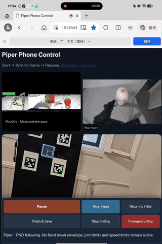

# A Quadratic Programming Based Teleoperation Scheme and Its Applications for Robotic Haircutting

This repository contains the full-text PDF, the presentation slides and all experiment code for the paper **"A Quadratic Programming Based Teleoperation Scheme and Its Applications for Robotic Haircutting"**.

| Content | Location |
| --- | --- |
| Paper PDF | [`paper/QP_Teleoperation_Robotic_Haircutting.pdf`](paper/QP_Teleoperation_Robotic_Haircutting.pdf) |
| Slides (17 pages) | [`slides/QP_Haircut_Teleop_talk.pdf`](slides/QP_Haircut_Teleop_talk.pdf) (PDF), [`slides/QP_Haircut_Teleop_talk.pptx`](slides/QP_Haircut_Teleop_talk.pptx) (PowerPoint, with animations) |
| Supplementary video | [`video/Supplementary_Video.mp4`](video/Supplementary_Video.mp4) |
| Experiment code | [`code/`](code) |

## Demos

**Application 1: heterogeneous leader-follower teleoperation.** An SO-101 leader arm teleoperates a Piper follower arm; simulation views with model-based hair coverage (left, center) and the camera view of the real arms (right).

<p align="center"></p>

**Application 2: smartphone-based teleoperation.** The phone camera observes a board of four AprilTags, and the estimated phone pose is the desired pose of the follower; the phone screen shows the MuJoCo view and the camera view of the follower.

<p align="center"></p>

## Overview

Teleoperation keeps the operator in the control loop and is a practical route toward real-world robotic haircutting, but structurally different (heterogeneous) leader and follower arms and the need for dedicated leader devices limit its use. The paper proposes a **quadratic programming (QP) based teleoperation scheme**:

- The follower tracks the desired pose given by the operator within its own **joint angle and joint velocity limits**, **without requiring a one-to-one joint correspondence** between leader and follower;
- The QP is solved online by a **discrete-time projection neural network**. The paper proves that the network converges globally and linearly to the optimal solution, and that **even with a single iteration per cycle** its output satisfies the joint limits at every time step;
- The scheme is applied to two robotic haircutting scenarios:
  1. **Heterogeneous leader-follower teleoperation**: an SO-101 leader arm operates a Piper follower arm to cut hair on a mannequin head;
  2. **Phone-based teleoperation**: the phone's rear camera observes a board of four AprilTags, and the estimated phone pose serves as the follower's desired pose, replacing the dedicated leader arm with a phone at lower cost.

## Method

At each control step k, solve for the follower joint velocity $\dot q$:

$$
\min_{\dot q}\ \tfrac12\big\|W\big(J(q_k)\dot q - k_e e_k\big)\big\|^2 + \tfrac{\lambda}{2}\|\dot q\|^2
\quad \text{s.t.}\quad \dot q^- \le \dot q \le \dot q^+
$$

where $e_k$ is the error between the desired pose and the current follower pose (position difference + rotation vector). The velocity bounds

$\dot q^- = \max\big(-\dot q_{\max},\,(q^- - q_k)/\Delta t\big)$, $\dot q^+ = \min\big(\dot q_{\max},\,(q^+ - q_k)/\Delta t\big)$

combine the joint angle limits and the joint velocity limits. With $H = J^\top W^2 J + \lambda I$ and $f = -J^\top W^2 k_e e_k$, the projection neural network iterates

$$
u \leftarrow (1-\alpha)\,u + \alpha\,P_\Omega\big(u - \gamma(Hu + f)\big),\qquad \gamma = 1/\lambda_{\max}(H)
$$

$P_\Omega$ is the projection onto the box constraint (element-wise clipping) and $\alpha\in(0,1]$ is the relaxation coefficient. The joint command is $q_{k+1} = q_k + u\,\Delta t$.

Where this lives in the code:

- [`code/mujoco_haircut/haircut_sim/pnd_ik.py`](code/mujoco_haircut/haircut_sim/pnd_ik.py): `build_qp()` builds $H, f$ and the velocity bounds, `solve()` runs the projection neural network iteration, and `step()` outputs the joint command; the parameter `relaxation` is $\alpha$ and `iterations` is the number of iterations per cycle.
- [`code/AprilTag_Precision_Lab/pnd_tracking.py`](code/AprilTag_Precision_Lab/pnd_tracking.py): the version used in the phone experiment, which adds velocity smoothing on top of the same QP.

## Repository structure

```
QP_Haircut_Teleop/
├── paper/                       # paper PDF
├── slides/                      # presentation slides (PDF and PowerPoint)
├── video/                       # supplementary video
├── media/                       # demo GIFs shown in this README
└── code/
    ├── requirements.txt         # Python dependencies (shared by both experiments)
    ├── docs/                    # installation, procedures for both experiments, data format
    ├── mujoco_haircut/          # Experiment 1: SO-101 leader → Piper follower, with a MuJoCo digital twin
    │   ├── haircut_sim/         #   QP construction and projection neural network solver, scene, hair coverage, recording, reports
    │   │   └── control/         #   Piper follower, SO-101 leader, kinematics, CAN backend
    │   ├── assets/              #   meshes and MJCF for Piper / SO-101 / the scanned mannequin head
    │   ├── pnd_alpha_experiment/ #  comparison of α = 1 and α = 0.2 (single iteration) from the paper
    │   ├── run_haircut.bat / calibrate_head.bat
    │   └── tests/
    ├── AprilTag_Precision_Lab/  # Experiment 2: phone + AprilTag board → Piper follower
    │   ├── server.py            #   HTTPS service for the phone web page (port 8443)
    │   ├── robot_bridge.py      #   real-robot following, clutch, head guard, logging
    │   ├── sim_bridge.py        #   simulation-only following
    │   ├── web/                 #   phone web page (AprilTag WASM detection)
    │   └── tests/
    ├── Client_RHCR/piper/       # Piper twin and kinematics used by the phone experiment
    └── analysis/                # scripts that plot the paper's comparison figures from experiment CSVs
```

The three directories under `code/` (`mujoco_haircut`, `AprilTag_Precision_Lab`, `Client_RHCR`) must stay side by side; the phone experiment finds the shared scene and twin code through relative paths. To place them elsewhere, set the environment variable `HHE_ROBOT_ROOT` to the folder that contains all three.

## Quick start

The experiments ran on Windows 10/11 with Miniconda (Python 3.12, environment name `lerobot`); see [`code/docs/01_installation.md`](code/docs/01_installation.md).

```bat
conda create -n lerobot python=3.12 -y
conda activate lerobot
cd code
pip install -r requirements.txt
pip install -e mujoco_haircut
```

Hardware-free self-test:

```bat
cd mujoco_haircut
python tests\test_standalone.py
python tests\test_pnd_ik.py
run_haircut.bat mock
```

`run_haircut.bat mock` runs for 10 seconds with a simulated leader and a simulated follower, opens the MuJoCo window, and produces one complete set of results under `mujoco_haircut/results/`.

## Reproducing the paper's experiments

| Paper content | Entry point | Documentation |
| --- | --- | --- |
| Application 1: SO-101 → Piper heterogeneous leader-follower teleoperation | `code/mujoco_haircut/run_haircut.bat` | [`docs/02_so101_leader_follower_teleop.md`](code/docs/02_so101_leader_follower_teleop.md) |
| Application 1: single-iteration comparison of α = 1 and α = 0.2 | `code/mujoco_haircut/pnd_alpha_experiment/` | same as above |
| Application 2: phone + AprilTag teleoperation | `code/AprilTag_Precision_Lab/start_phone_teleop_piper_pnd.bat` | [`docs/03_phone_apriltag_teleop.md`](code/docs/03_phone_apriltag_teleop.md) |
| Paper figures for tracking error, α comparison, etc. | `code/analysis/*.py` | [`docs/04_data_format_and_analysis.md`](code/docs/04_data_format_and_analysis.md) |

The raw experiment data (CSVs, videos) is large and not included in the repository; the format of the results produced by each run is described in `docs/04`.

## Hardware

- Follower: AgileX Piper (6 joints), connected via USB-CAN (gs_usb / candleLight), interface name `can0`
- Leader (Application 1): SO-101 leader (Feetech STS3215 servos), serial port `COM6` by default
- Phone (Application 2): a phone with a rear camera that runs Chrome / Safari, on the same LAN as the computer
- AprilTag board (Application 2): tag36h11, IDs 0–3 in a 2×2 layout, black-border side 50 mm, gap 100 mm
- Clipper: held in the Piper gripper, with its tip 0.20 m along the flange z axis
- Head: scanned mannequin head `assets/head/HeadScan.stl`

## Safety

The code drives a real robot arm. All experiments were performed on a mannequin head and have not been validated on people; the head guard in simulation is based only on the head model position in MuJoCo and is no substitute for physical safety measures. Always keep a hand on the emergency stop when running the real robot.

## Third-party resources

- The Piper model comes from [MuJoCo Menagerie](https://github.com/google-deepmind/mujoco_menagerie) and the SO-101 model from [SO-ARM100](https://github.com/TheRobotStudio/SO-ARM100); see `code/mujoco_haircut/assets/*/LICENSE` for their licenses.
- The AprilTag WASM detector (`code/AprilTag_Precision_Lab/web/vendor/apriltag/`) is based on [AprilRobotics/apriltag](https://github.com/AprilRobotics/apriltag).
- The leader driver uses [LeRobot](https://github.com/huggingface/lerobot) and the follower driver uses [piper_sdk](https://github.com/agilexrobotics/piper_sdk).
